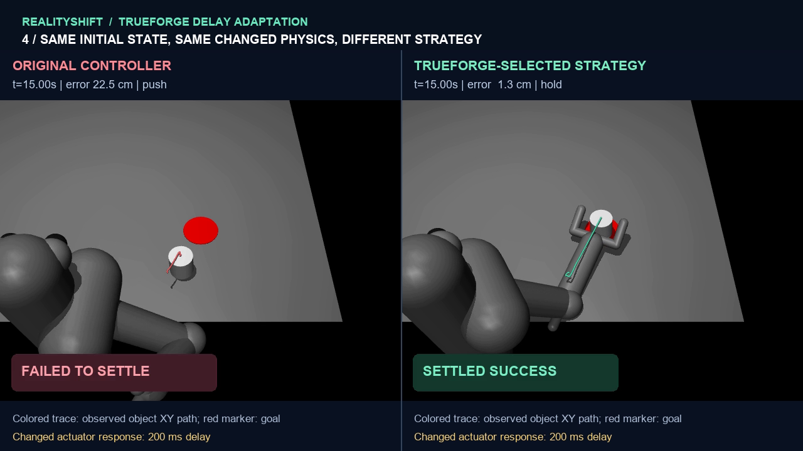

# RealityShift

**A robot's response changes. Its old strategy fails. An AI agent diagnoses the
behavior, saves a different control strategy, and verifies that the robot can
complete the same task.**

RealityShift is a MuJoCo robotics research prototype connecting real TrueForge
agent decisions to bounded, independently evaluated robot-control strategies.
The agent selects developer-authored primitives; it does not write unrestricted
controller code or change the physics or scoring.

**[Watch the 75-second demonstration](demo/assets/realityshift_adaptation_v3.mp4)** ·
[Replay viewer](demo/adaptation.html) ·
[Results and limitations](docs/ADAPTATION_V3.md) ·
[Evaluation protocol](docs/V3_PROTOCOL.md)

[](demo/assets/realityshift_adaptation_v3.mp4)

## Recorded agent adaptation

The NVIDIA-backed TrueForge agent observed failed development runs, selected a
stabilized recovery policy, saved [s0002](strategies/v3/versions/s0002.yaml), evaluated every paired validation
condition and called promotion successfully. The original controller succeeded
on **3/21** validation tasks; the actual agent-selected policy succeeded on
**21/21**, preserving every original success. This includes all nine tasks with
constant delay and all nine where actuator delay begins mid-task.

The visual example uses the same starting state, goal and 200 ms actuator delay
beginning at 3 seconds. The original controller fails; the agent-selected
strategy completes the task. Its diagnosis, YAML revision, tool calls and
trajectories are recorded rather than hypothetical reasoning.

Final held-out results and uncertainty are reported in the linked results file.
The final policies are frozen before testing; final outcomes are not used for
further tuning. Validation success alone is not a generalization claim.

| Policy | Validation | First final test | Mean final goal error |
| --- | --- | --- | --- |
| Original | 3/21 | 5/25 | 14.67 cm |
| Developer adaptive recovery | 14/21 | 20/25 | 3.16 cm |
| Conventional search | 14/21 | 20/25 | 3.16 cm |
| **TrueForge-selected stabilized recovery** | **21/21** | **25/25** | **0.95 cm** |

The final test has five starting-seed clusters, not 25 independent starting
positions. The small predeclared random search omitted the stabilized approach;
these results do not establish superiority over exhaustive or better-covered
optimization. A [15-second final-test replay](demo/assets/realityshift_heldout_repush_v3.mp4)
also shows an actual stall, controlled backoff/repush and settled success.

## Watch locally

```powershell
conda activate RealityShift
python -s -m http.server 8802 --bind 127.0.0.1 --directory demo
```

Open **http://127.0.0.1:8802/adaptation.html**. The viewer plays recorded,
state-verified robot simulations; it needs no API key or model session.

## Install and verify

```powershell
conda env create -f environment.yml
conda activate RealityShift
python -s -m pytest -q
python -s -m evaluation.v3.evidence docs/evidence/adaptation-v3/experiment
```

Use `python -s` to exclude global user packages. The pinned dependencies are in
`requirements-lock.txt`; optional TrueForge/demo dependencies are separate.
Offline verification re-scores saved observations and checks actual agent tool
receipts without launching a model or new simulation.

This checkout contains completed experiments. Session, search and final-test
reservations refuse accidental repeat runs or budget resets. A new experiment
requires a separately declared version; do not delete receipts to start over.

## How it works

1. The original high-gain controller encounters changed actuator response.
2. Observation histories distinguish tracking oscillation, contact acquisition,
   slow productive pushing and failure to settle.
3. TrueForge chooses a bounded strategy configuration and persists its hypothesis
   and YAML revision through six allowlisted MCP tools.
4. Independent full-suite evaluation checks paired task completion, errors,
   effort and recovery decisions. Promotion cannot discard an original success.
5. A one-shot final test compares original, developer, conventional-search and
   agent-selected policies on previously unopened seeds and delay settings.

Available primitives include stabilized/adaptive approach, controlled repush,
reachable repositioning, contact reacquisition, progress-gated tracking memory
and observed-motion braking with joint-pose hold. Torque remains within ±2;
episodes last 15 seconds. Success requires staying within 5 cm for the final
ten steps. The agent cannot read hidden delay values, modify the evaluator,
execute Python or choose easier conditions.

| Area | Main files |
| --- | --- |
| Robot strategies | `control/response_recovery.py`, `control/progress_recovery.py` |
| Strict policy schema | `control/adaptation_schema.py` |
| Agent workflow and tools | `agent/adaptation_bridge.py`, `agent/adaptation_instructions.md` |
| Delay onset simulation | `simulation/delay_shift.py` |
| Three-split evaluation and evidence | `evaluation/v3/` |
| Authentic video and trajectory overlays | `demo/adaptation_demo.py` |

## Practical motivation and limits

Manipulation and assistive robots may face unfamiliar payloads or degraded
actuator response. RealityShift studies whether an agent can select an effective
recovery strategy from observed failures while keeping evaluation independent.
It is an experimental foundation, not a deployed assistive-care system.

The evidence comes from a single simulated arm/task, a known nominal robot model
and small groups of starting seeds. Contact is inferred geometrically, not
measured by a force sensor. There is no physical-hardware or clinical validation,
formal stability guarantee, or claim of safe unsupervised care.

## Preserved earlier experiments

All original benchmarks, held-out results, skills, budget receipts and TrueForge
evidence remain unchanged. V3 is separate because v1 and v2 were already frozen.
Scores across versions are not directly comparable: their condition sets differ.

- **V1 numeric-skill experiment:** actual agent development score 35.24 → 41.83
  (5/15 → 6/15); held-out success stayed 5/15 and score regressed from 36.45 to
  34.70. Conventional random search scored 44.62 on development. These limitations
  remain in [the original results](docs/AGENT_RESULTS.md).
- **V2 strategy experiment:** developer baseline 15/21; agent candidate 10/21,
  not promoted. A corrective follow-up was disclosed in
  [the v2 agent report](docs/STRATEGY_AGENT_RESULT.md).
- **Later developer increment:** 19/21 on reused v2 development cases, without
  an agent improvement claim. See [progress-aware recovery](docs/PROGRESS_RECOVERY.md).
- [Historical setup and command reference](docs/README_V1_V2_ARCHIVE.md) preserves
  the previous README, including older experiment-specific status statements.

The project remains unlicensed for its original code, as requested by its owner.
